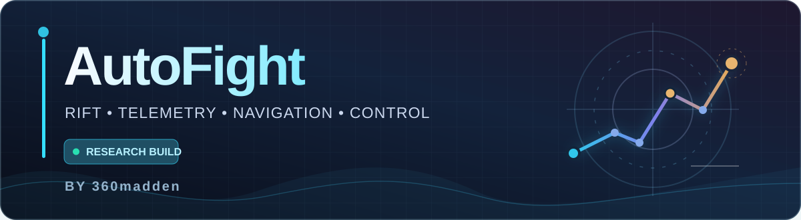
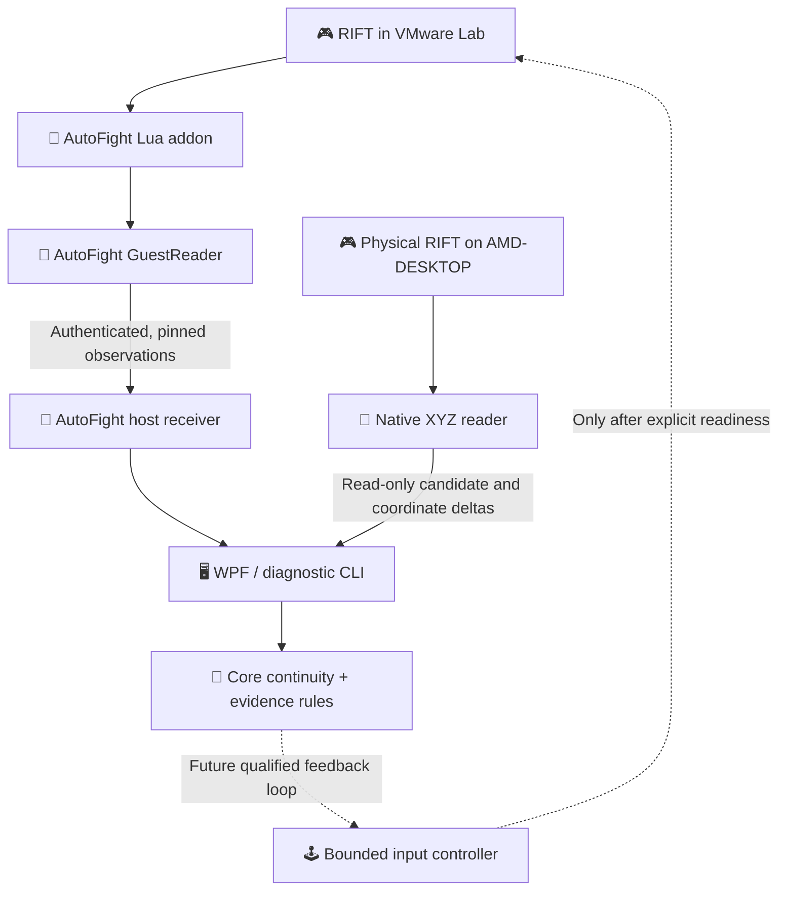

<p align="center">
  
</p>

<div align="center">

[](#-quick-start)
[](#-architecture)
[](#-architecture)
[](#-architecture)
[](#-verified-status)

**An independent RIFT observation and automation workbench**

*From source-verified telemetry toward measured movement, navigation, and eventually combat.*

[What works](#-verified-status) · [Architecture](#-architecture) · [Quick start](#-quick-start) · [Roadmap](#-next-milestones) · [Developer handoff](SESSION_HANDOFF.md)

</div>

> [!IMPORTANT]
> **AutoFight is an active development project—not a finished autonomous RIFT player.** On November 15, its own current-build native reader obtained real XYZ candidates from physical RIFT on AMD-DESKTOP without any RR2 service or gameplay input. The first/default desktop tab now supports explicit read-only native XYZ sampling and baseline/coordinate-difference comparisons. **Passive producer freshness, matching VMware addon telemetry, sustained 480-second qualification, and measured game movement remain unverified.** The earlier Lab 2 Reader-to-host transport alone is not game data.

## ✨ What is AutoFight?

AutoFight is a modular **C# / .NET 10 / WPF** Windows project exploring a reliable, observable path from RIFT game state to independently verified actions. The physical Windows RIFT client on AMD-DESKTOP is the current read-only XYZ target; earlier VMware lab integrations remain available as separate historical/development paths. The design emphasizes **one clear owner for input**, explicit game/session identities, bounded operations, and evidence that an action actually changed the world.

| 🧩 Component | Purpose | Current implementation |
| :--- | :--- | :--- |
| 🖥️ **Desktop workbench** | On-demand physical RIFT XYZ, identity-pinned comparisons, VM diagnostics and replay | First/default physical XYZ WPF tab and CLI commands |
| 🧠 **Core engine** | Typed observations, freshness, event continuity, deterministic analysis | Standalone .NET library with regression tests |
| 📡 **Host receiver** | Accept authenticated, identity-bound updates from a guest | Independent AutoFight in-process listener and watch CLI |
| 📍 **Physical native XYZ** | Read current-build RIFT memory, classify consecutive coordinates | Exact-process C# read-only reader + pure comparison tracker; no game input |
| 🕵️ **GuestReader** | Inspect the pinned RIFT process for addon-produced frames | AutoFight-owned Windows executable and scanner |
| 🌙 **RIFT Lua addon** | Emit identifiable game observations within permitted addon APIs | Six source-controlled Lua assets |
| 🕹️ **Control foundation** | Preflight, ownership, bounded pulse and response attribution | Legacy supervised bridge and synthetic executor; *no verified game motion* |

**Project boundary:** AutoFight owns its source code, tests, addon, GuestReader, host receiver, and independent build products. [RiftReader2](https://github.com/360madden/RiftReader2), the historical RiftReader projects, and other research repositories are references or optional *development* integrations—not required source checkouts for the owned data path. Some older desktop diagnostic/control UI still supports an optional legacy RR2 bridge while migration continues.

## 🚦 Verified status

<sub>Evidence snapshot: November 15 physical native XYZ; November 6–7 VMware evidence remains historical. Revalidate process identities on every use.</sub>

| Area | Status | Evidence / limitation |
| :--- | :---: | :--- |
| .NET 10 solution + WPF smoke | 🟢 | Release build and deterministic offline test suites previously passed |
| AutoFight-owned addon + GuestReader | 🟢 | Built independently of RR2 assemblies; six addon files verified on Lab 2 disk |
| Guest → host transport (Lab 2) | 🟢 | Authenticated Reader deliveries observed in a bounded live watch |
| In-game addon load and private binding | 🟡 | On-disk assets verified; active addon/bound nonce not yet established |
| Fresh XYZ from matched addon frame | 🔴 | 40/40 host polls unavailable; Reader reported no matching frame |
| 480-second continuous telemetry | 🔴 | Acceptance logic exists; no AutoFight-owned live passing result |
| Actual controlled movement with XYZ change | 🔴 | No verified input-to-position feedback loop |
| Physical native read-only XYZ provider | 🟢 | AutoFight-owned exact-build C# reader acquired actual physical RIFT XYZ repeatedly on Nov 15; 4/4 samples in the latest watch, all candidate-only |
| Physical XYZ WPF and coordinate comparisons | 🟢 | First/default on-demand tab, fail-closed stale/identity checks, Baseline/Unchanged/Changed deltas; 7 synthetic smoke categories passed, not a visible UI test |
| Targeting, navigation, spell rotation | 🔴 | Future work; no qualified autonomous combat |

**Interpreting the evidence:** A network-delivered Reader status is **not** necessarily a game telemetry frame. A game input acknowledgment is **not** proof the character moved. The project deliberately records these as separate acceptance gates.

## 🏗️ Architecture



- **Process and build identity:** measurements must match the correct game image, process start, lab, and Reader instance.
- **Explicit freshness:** advancing transport is tracked separately from advancing producer data and accepted XYZ.
- **Standalone runtime direction:** the owned telemetry path has no RiftReader2 project reference or RR2 runtime service requirement; legacy UI/controller migration is still ongoing.
- **Operational safety:** input actions have explicit bounds, cancellation and ownership; invalid, stale, or uncertain observations fail closed.

See the [architecture decision record](docs/automation-platform-architecture.md) for contracts and the [technical roadmap](docs/automation-platform-roadmap.md) for acceptance gates.

## 🚀 Quick start

### Requirements

- Windows 11 x64
- **.NET 10 SDK**, matching the repo's `global.json` (SDK feature band `10.0.302`, newer patch permitted)
- PowerShell and Git
- VMware and RIFT are **not required** for builds, offline tests, or WPF smoke checks

From **Windows PowerShell**, inside a clone of this repository:

```powershell
git clone https://github.com/360madden/AutoFight.git
Set-Location .\AutoFight
dotnet build .\Rift.Automation.slnx -c Release
dotnet run --project .\src\Rift.Automation.Desktop\Rift.Automation.Desktop.csproj -c Release
```

### 🧪 Tests

Run from the repository root in Windows PowerShell:

```powershell
dotnet run --project .\tests\Rift.Automation.Specs\Rift.Automation.Specs.csproj -c Release -- selftest
dotnet run --project .\tests\Rift.Automation.Windows.Specs\Rift.Automation.Windows.Specs.csproj -c Release
dotnet run --project .\tests\Rift.Automation.Guest.Specs\Rift.Automation.Guest.Specs.csproj -c Release
dotnet run --project .\src\Rift.Automation.Desktop\Rift.Automation.Desktop.csproj -c Release -- --smoke-test
```

Tests exercise synthetic/offline cases. A passing smoke test does **not** establish a visible desktop experience or a successful live game input.

### Native XYZ diagnostic (physical RIFT)

The new standalone reader is **read-only**. Run `--clients` first to obtain the exact PID and `Identity` (`PID:process-start-UTC-ticks`), then use those values in the native commands:

```powershell
dotnet run --project .\src\Rift.Automation.Desktop\Rift.Automation.Desktop.csproj -c Release -- --clients
dotnet run --project .\src\Rift.Automation.Desktop\Rift.Automation.Desktop.csproj -c Release -- --physical-xyz <pid> <start-utc-ticks>
dotnet run --project .\src\Rift.Automation.Desktop\Rift.Automation.Desktop.csproj -c Release -- --physical-xyz-watch <pid> <start-utc-ticks> 5
```

The executable's SHA-256 must exactly match the pinned current-build recipe. An accepted `Candidate` means an anchored, newly acquired memory reading—not independently proven producer freshness, movement, or permission to automate. The watch is explicitly bounded, emits **Baseline/Unchanged/Changed** coordinate comparisons and 3D deltas, and never controls RIFT.

For the on-demand desktop observer, launch AutoFight without CLI arguments. In the first tab **Physical RIFT – Live XYZ**, click **Refresh physical RIFT clients**, select the exact RIFT process, then **Start read-only XYZ**; use **Stop sampling** to cancel. The desktop acquires about once per second, clears stale or invalid coordinates and never moves or focuses the game. The tab's synthetic smoke has passed; a visible interactive click-through remains outstanding. See the [first native XYZ evidence](docs/M1-PHYSICAL-NATIVE-XYZ-2026-11-15.md) and [live comparison/desktop milestone](docs/M2-PHYSICAL-XYZ-CONTINUITY-UI-2026-11-15.md).

### 📦 Optional self-contained desktop build

```powershell
dotnet publish .\src\Rift.Automation.Desktop\Rift.Automation.Desktop.csproj -c Release -r win-x64 --self-contained true -p:PublishSingleFile=true -p:IncludeNativeLibrariesForSelfExtract=true -p:PublishTrimmed=false -p:DebugType=none -p:DebugSymbols=false -o .\artifacts\local\autofight-win-x64
```

This creates a local unsigned executable—not a GitHub release or installer. The separately built GuestReader and private lab configuration are only needed for advanced, explicitly configured live observation. **Do not commit local tokens, reader nonces, or host/lab configuration files.** See [GuestReader notes](docs/M1-standalone-guest-port-2026-10-31.md).

## 🗺️ Next milestones

| Priority | Milestone | Acceptance target |
| :---: | :--- | :--- |
| **P1** | First trustworthy Lab 2 XYZ | Prove addon loaded/bound and host receives fresh, identity-matched position |
| **P2** | Physical XYZ comparison and freshness qualification | Native reader, coordinate comparison and desktop observer implemented Nov 15; next observe a user-driven position change, visible UI behavior and independent producer freshness |
| **P3** | Freshness and movement verification | Sustain the 480-second window; separately observe one reviewed small movement pulse |
| **P4** | Standalone input path | Remove the remaining legacy controller runtime requirement |
| **P5** | Navigation and combat | Add target/ability state, movement planning, collision/LOS and recovery only on qualified feedback |

## 📚 Project documentation

| Document | What you'll find |
| :--- | :--- |
| [Session handoff](SESSION_HANDOFF.md) | Most recent continuation links and repository routing |
| [Current status](docs/current-status.md) | Verified implementation, test receipts, and outstanding gates |
| [Live physical XYZ continuity + WPF milestone](docs/M2-PHYSICAL-XYZ-CONTINUITY-UI-2026-11-15.md) | Latest 4/4 read-only watch, comparison semantics, 333 tests and desktop scope |
| [Lab 2 first-XYZ handoff](docs/HANDOFF-AUTOFIGHT-LAB2-FIRST-XYZ-2026-11-06.md) | Exact source/Reader transport outcome and next lab steps |
| [Architecture](docs/automation-platform-architecture.md) | Contracts, identity, state and provider arbitration |
| [Roadmap](docs/automation-platform-roadmap.md) | Development milestones and acceptance gates |
| [Developer instructions](AGENTS.md) | Project ownership, engineering and build requirements |

---

<div align="center">

**AutoFight** · Created and maintained by **[360madden](https://github.com/360madden)**

<sub>Built to turn telemetry into verifiable behavior—one measured milestone at a time.</sub>

</div>
