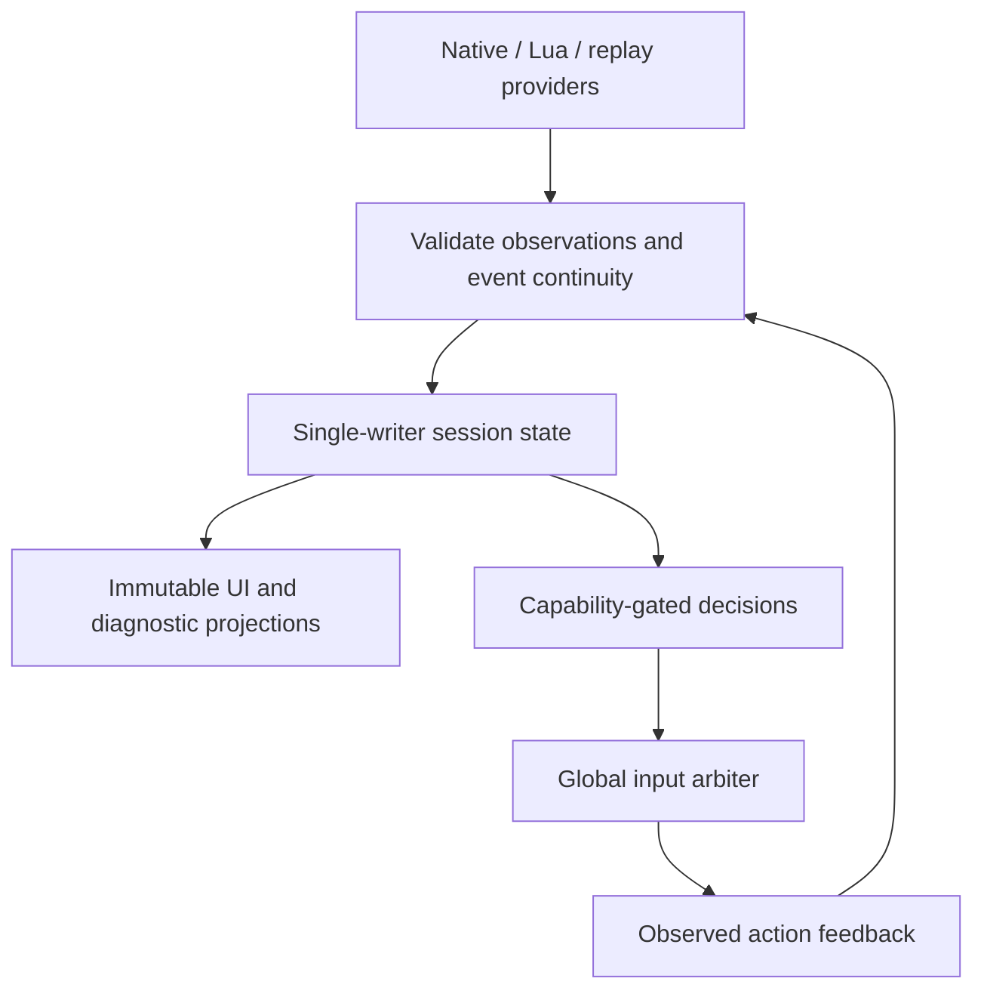

# Automation platform architecture

Date: 2026-10-30
Status: working design; implementation claims belong to the status receipt.

## Decision and scope

Build a Windows-only C#/.NET 10 modular monolith: one desktop process, replaceable observation providers, a platform-neutral decision core, and a single Windows input owner. "Hybrid" describes temporary Lua plus native C# data acquisition, not an embedded web UI. The owning repository is `C:\work\AutoFight`; the older `C:\work\Rift API` repository remains independent API-discovery research.

The application must not require RiftReader2, RRE/REA, Workbridge, another research checkout, a cloud service or an LLM at runtime. Those are development/reference sources. Existing collector protocols and manual behavior remain compatible.

This is a design, not a claim that native fields, automated combat or navigation currently work. [Status/evidence](automation-platform-status.md) records what is actually implemented/tested. [Roadmap](automation-platform-roadmap.md) sets acceptance gates. Joey's subsequent instruction to keep going autonomously authorizes the scoped observation-only foundation after design review, not game input or deployment.

## ADR-001: Small physical structure, strong logical seams

Start with three production assemblies, created only as needed:

| Assembly | Responsibility | Must not do |
| --- | --- | --- |
| `Rift.Automation.Core` (`net10.0`) | Typed state, temporal rules, capability checks, deterministic reducers and later target/cast/movement decisions | Reference WPF, HWND, native structs, OS input, process memory or live clocks directly |
| `Rift.Automation.Windows` (`net10.0-windows`) | Concrete process/session inventory, read-only native memory, approved capture adapters and eventually input arbitration | Decide combat policy or silently authorize live actions |
| `Rift.Automation.Desktop` (`net10.0-windows`, WPF) | Composition, view models, diagnostic UI, profiles and explicit controls | Own authoritative game state or directly sample memory on the UI thread |

Use project-local `src/` and separate automated tests; preserve `addon/RiftApiCollector`, other tools/readers and the Python/Lua collector tests in the **separate Rift API repository**, not in AutoFight. Do not create a DLL per future subsystem. M2 instantiates only session/observation/projection/replay seams; defer action/actor/telemetry contracts and the Windows assembly until an actual implementation requires them. A headless diagnostic CLI may later reuse the core; a fourth contracts assembly, plugin loader, actor framework, service bus or helper process requires a demonstrated need.

WPF is the initial maintainability choice for this Windows-only tool, not a claim of benchmark superiority over WinUI. Keep it replaceable through view models. Use constructor injection first; add infrastructure only when it removes actual duplication. Native unsafe code stays in the Windows boundary. Start with managed/runtime APIs and minimal interop; evaluate CsWin32 when native declarations are needed.

## ADR-002: State ownership and execution

One serialized session loop owns each client's mutable state and attempt lifecycle. Async provider/path/input completions post immutable messages tagged with session and request epochs; callbacks never mutate session state. This is a plain bounded loop, not a requirement for an actor library.

Two different data paths are essential:
- State samples: latest valid sample per provider/field group may be coalesced with explicit sequence accounting.
- Significant events: ordered bounded queues, never silently coalesced. Overflow or sequence gaps invalidate affected event-derived conclusions; they do not become synthetic success/failure events.

There is no claim of lossless transport. Queue limits, high-water marks and dropped ranges are visible. Lifecycle invalidation and stop requests must not sit behind an unbounded backlog. An execution epoch logically fences not-yet-issued actions; the session writer records the transition. It cannot undo already emitted input. Before input implementation, define and test stop-versus-issuance ordering. A slow UI cannot stall collection or make old samples appear fresh.

## ADR-003: Identity, time and normalized contracts

Use strongly typed records and explicit optional values, not string-keyed global bags.

| Contract | Required meaning |
| --- | --- |
| `SessionIdentity` | Opaque session ID plus process PID, creation time, executable hash, image identity and Windows-owned window/mapping binding; Core receives opaque identifiers, not HWND |
| `Observation<T>` | Value/status, field/source/schema, session and source epochs, sequence, acquisition interval, producer-time availability, host receive monotonic time, validity policy and evidence category |
| `GameSnapshot` | Immutable revision of the best currently accepted observations; not an atomic read of the world |
| `ActorIdentity` | Session + observed game ID + known spawn/generation information; if continuity is unknown, invalidate rather than assume ID reuse means the same actor |
| `CapabilityStatus` | Available/unavailable/degraded with explicit missing prerequisites and reasons |
| `ActionIntent` | Request ID, session/plan epoch, target/ability identity, relevant snapshot preconditions, deadline and required capabilities; never direct input |
| `ActionFeedback` | Issuance result separately from observed game result, evidence correlation and terminal reason |

Keep three facts separate: observation recency, producer liveness and event continuity. Capture/receive timestamps from different clocks are not comparable until their mapping and uncertainty are established. Use an injected monotonic clock for intervals; UTC is diagnostic metadata only. Native reads without producer timestamps report acquisition recency and semantic uncertainty, not invented production time.

Repeated equal positions may be perfectly fresh stationary observations. Conversely, recapturing the same old pixel frame does not refresh its sample age. A newly accepted invalid/error/missing sample invalidates the previous current reading; it must not silently preserve current-valid status. Last-known values may remain separately visible as stale diagnostics, never eligible for actions; alternate sources require explicit fallback policy. No nil/invalid/unknown-to-zero or false substitution; zero and false can be real data.

Statuses distinguish missing, unsupported, invalid, error and stale. Evidence categories (synthetic, historical, current-build observed, qualified) are not invented probability percentages. No certainty is implied by a CRC.

Invalidate at the right scope: process restart/build change invalidates the entire session; window rebinding invalidates capture/input binding; addon reload invalidates its source epoch; zone/character change invalidates world/actor state; role/profile change invalidates ability mapping and pending decisions. Old async results cannot resurrect invalidated state.

## ADR-004: Field-specific source arbitration

Providers expose availability; they do not decide their own authority. Configure a reviewed policy per field/capability, not universal "native always wins."

Prefer the qualified source for that field on the exact build. Compare contemporaneous observations only within compatible identity, coordinate frame and timing bounds. Disagreement outside a verified tolerance marks the field disputed and pauses dependent actions; never average mismatched positions, identities or clocks. A fallback must independently meet the same semantics/freshness requirements.

Hybrid, native-preferred and native-only are capability modes. Native-only may initially offer only diagnostics. Reading addon-owned values from process memory is still Lua-dependent and cannot satisfy native-independence parity.

## ADR-005: Preserve the collector; isolate disposable telemetry

Keep `RiftApiCollector 0.5.0` in the **independent Rift API repository** as the manual discovery/validation instrument; AutoFight only owns its tested local TSV parser compatibility copy. Preserve:
- manual-only reads; no background sampling added to this addon;
- valid manifest Email, existing file order and private namespace;
- frozen `RAC-TSV/1`, `RAC-AL-TSV/1` and `RAC-CONSOLE-B64/1` semantics;
- explicit user copy/export and no implicit resampling;
- existing offline byte fixtures and release tooling.

If runtime Lua is needed, build a separate, separately versioned and opt-in telemetry addon in this repository after its transport gate. It supplies observations only, never combat decisions or input. Reuse small pure normalization/codec patterns where justified, not mutable collector state.

A proposed `telemetry-frame/1` includes protocol/schema, addon build, boot generation, stream kind, wide sequence, sample counter, heartbeat, optional Frame-clock capture value, field validity and integrity check. Desktop independently binds the provider to a verified process/window/build; Lua is not assumed to know PID. A checksum detects corruption, not identity, liveness or authenticity.

First payload is deliberately small: player identity and one selected useful field, then XYZ/HP/combat/dead as independently validated. Target and casting fields follow after baseline fidelity. Snapshot and event streams have separate sequence/gap accounting. No assumed raw sockets, arbitrary file writes, immediate SavedVariables publication or in-game messaging as Windows IPC. Optical capture and addon-memory readback are candidates, not verified transports.

Retire Lua field-by-field only after current-build independent native semantics, missingness, accuracy, timing tails, restart and native-only capability tests pass. Matching a few stationary values is insufficient. Retain an optional diagnostic addon if it remains useful.

## ADR-006: Native read-only acquisition

Separate discovery from runtime sampling. No whole-process scan in the sampling loop.

- Bind an explicit process handle to PID + creation time + image/build identity and mapping generation. Recheck on restart, exit, window rebinding and mapping changes.
- A build catalog selects exact-hash recipes. Unknown build means unsupported; never try an old offset because it looks plausible.
- Validate checked address arithmetic, canonical/aligned pointers as required by the recipe, committed readable non-guard regions, exact byte counts and typed field constraints. Region preflight is not a guarantee that the following read succeeds.
- Cache immutable recipe/module data. A resolved object address is only a bounded-lifetime hint; recheck root/critical hops and identity. Pointer turnover, partial reads or failed invariants invalidate it.
- Cross-process reads are not an atomic world snapshot. Use bracketed identity/sequence checks where available, bound acquisition span, and reject detected torn samples. Document residual races; bracket reads are not a universal atomicity guarantee.
- Treat finite/range/subnormal rules per field and evidence. Do not globally reject every near-zero float.
- Dispose handles on all exits; use least required read/query access. No memory writes, injection, kernel driver or runtime game-function calls are part of the initial design.

Keep `PlayerPose` and `CameraPose` separate. Every coordinate frame states axis order, units, handedness, scene/origin and calibration. Angles state radians/degrees, sign and wrapping. FOV states horizontal/vertical and units; matrices state layout/viewport. Unknown conventions disable facing/projection rather than produce plausible wrong overlays.

The old-build XYZ recipe is reference evidence only; current-build XYZ authority, body yaw and camera parameters remain gates in the status ledger.

## ADR-007: Action and global input ownership

Per-session loops own intentions and attempt state. Exactly one global arbiter owns physical keyboard/mouse emission and the owned-key ledger. A session cannot release another session's keys.

A lease contains session/plan epoch, verified window binding, allowed action, deadline, focus assumptions and owned keys. Recheck identity, capability prerequisites and the relevant snapshot predicates just before issuance; stale intents are rejected. Recheck focus/outcomes afterward. No simultaneously held keys across independently focused clients.

Global foreground input cannot be atomically bound to a target HWND. Pre/post checks mitigate, but do not eliminate, OS/user focus races. Input API insertion counts are not delivery or game acceptance. Partial/zero insertion, uncertain focus or unexplained feedback must produce an explicit ambiguous result and disarm affected actions; do not blindly resend a possibly issued cast.

Stop, cancellation, timeout, exception and manual takeover invalidate leases for not-yet-issued work and attempt bounded release of only application-owned keys. Do not release arbitrary keys held by the user. Key release after hard crash, inaccessible desktop, lock/UAC or an ambiguous insertion cannot be guaranteed; surface unresolved ownership and require explicit recovery/rearming. Startup is disarmed; never auto-resume after process/app restart.

Action work must first define supported foreground/capture mode, DPI/window scaling, keyboard layout/keybindings, privilege level, chat/modal detection and manual activity policy. Default unsupported/uncertain conditions to observation-only. Three concurrent observers do not imply three concurrent physical-input channels.

## ADR-008: Target and cast-aware behavior

Begin with deterministic profile priorities, not ML/GOAP infrastructure. Pure eligibility/selection functions consume normalized state; separate state machines own execution and recovery.

Target lifecycle:
1. Filter hard eligibility (identity, alive/hostile, required range/visibility/route facts) before scoring.
2. Retain a valid target using explicit switching hysteresis; optional scoring cannot bypass eligibility.
3. Acquire/switch/release requests are intents, followed by observed selected-target confirmation.
4. Bound reacquisition, per-target failure counters and temporary blacklist lifetime. No target or no eligible plan is an explicit idle/recovery state, never a spin loop.
5. Death, despawn, ID reuse, pet threat, targetless combat and role changes invalidate the relevant decisions.

Cast attempts track Requested, Issued and optional Started, then one terminal outcome: Confirmed, Failed, Interrupted, Cancelled, TimedOut or Unknown. Correlate attempt/session/ability/target and evidence interval. Exactly-once terminal state is an internal rule, not a claim of exactly-once game execution.

A castbar need not exist for instant abilities. Confirmation requires appropriately correlated cooldown/resource/combat/buff evidence or explicit events with validated semantics; unrelated resource changes are not enough. Missing events or a vanished castbar are not proof of success. Late evidence is retained diagnostically but cannot resurrect an ended attempt. Ambiguous attempts require reconciliation before retry.

Casting and movement share action resources: casting restrictions, turn/range requirements and input ownership must agree. Avoid approach/cast/cancel/reacquire oscillations with bounded recovery and measured deadlines. Keybindings and class/role profiles are validated data, not hard-coded assumptions about Q/E or action-bar slots.

## ADR-009: Geometry, navigation and measured movement

Investigate geometry early in parallel with the first observer. Keep these separate capabilities:

| Layer | Input | Result |
| --- | --- | --- |
| Geometry provider | Current-build scene assets or qualified collision evidence | Versioned, calibrated surfaces/triangles and provenance |
| Navmesh builder | Geometry + player radius/height/step/slope | Layered walkable topology; DotRecast remains a candidate |
| Route planner | Scene, goal, topology revision, agent constraints | Complete, partial, unreachable or unknown 3D corridor |
| LOS/clearance | Validated ray/swept-shape semantics and geometry | Clear, blocked or unknown; distinct from walkability |
| Local steering | Corridor, nearby actors and bounded deviations | Short control intent, not invented static geometry |
| Movement feedback | Fresh poses and control history | Progress, arrival, overshoot, stuck or unknown |

A route includes session, scene, target identity/pose version, geometry revision and cancellation epoch. Recheck before applying asynchronous results and before each segment. Replan with bounded distance/time thresholds on moving targets, obstructed corridors or geometry revisions; never rebuild everything every tick.

Travel direction inferred from displacement is not body facing: strafing, backpedaling and knockback break that assumption. Without qualified yaw, only separately calibrated and supervised short control pulses in vetted open ground may be considered. No arbitrary turn/facing capability is implied.

Arrival requires compatible scene and connected surface/layer plus horizontal/vertical tolerances and fresh feedback, not XZ equality beneath a bridge. Unknown collision geometry means unknown obstacle-aware route/LOS. A readable list of unit positions does not reveal walls or terrain.

Geometry gate: extraction/provenance, units/axes/origin calibration, independent landmark agreement, layered bridge/underpass and stair/ramp fixtures, capsule clearance and reproducible queries, then separately approved held-out live traces. Failure keeps an explicitly reduced product (observer/open-terrain steering or authored routes with stated limits); it does not block the diagnostic desktop or justify a false full-3D claim.

## ADR-010: Defensive implementation and measured efficiency

- Prefer pure functions, nullable/strong types, bounded collections and explicit result types for expected failures. Exceptions at provider/OS boundaries become typed diagnostics and capability changes; do not swallow and continue acting.
- Inject clock/providers/executor; cancellation is checked after each async boundary against the same epoch. Use bounded deadlines/backoff only where retry is valid.
- Keep discovery, schema parsing, normalization, policy, execution and UI separate. Minimize allocations in measured hot paths; batch only compatible reads and preserve non-atomicity metadata.
- Use immutable snapshots for consumers. Coalesce UI refresh separately from decision cadence; do not poll all ability details per frame.
- Profile before pooling, unsafe optimization, lock-free structures or helper-process isolation. A modular monolith is logical isolation, not protection against a process crash.
- Bound logs/replays by bytes/time, redact private IDs and never commit raw memory/screenshots. Report provider errors with source/recipe IDs, not secret payloads.
- Configuration is schema-versioned and validated before applying atomically; invalid profiles remain disarmed. Never execute arbitrary profile scripts in the first design.
- Keep SDK/dependency versions explicit, warnings as errors, focused code review and a regression fixture for significant bugs. Preserve the existing collector tests.

## Verification and operational support

Replay records schema, synthetic/sanitized session/build, provider epochs, deterministic monotonic offsets, arrival ordering, read/error/event/input-result kind, sequence/overflow flags and expected state/attempt transitions. Snapshot checkpoints accelerate seek but do not replace event history. Use a virtual clock and a deterministic same-tick tie-breaker; repeated runs must match the entire transition trace.

Required cases include PID reuse, wrong build, pointer turnover, partial reads, valid zero, stale pixel imagery, source disagreement, event gaps, target death during cast, late callbacks, no plan, role change, focus steal, partial input, cancellation at every boundary, stacked surfaces, partial routes and shutdown. Replay never invokes a real input provider.

Measure one client before three: sample count and environment, p50/p95/p99 acquisition-to-state and source-age distribution, queue wait, UI lag, input-to-feedback, CPU, allocations/GC, handles, rejection/overflow and path latency. Derive maximum acceptable age/deadlines from capability semantics, then measure whether the game/transport meets them. Do not relax liveness or increase maximum age to hide a failing transport, and do not invent performance guarantees. Correctness gates are deterministic; performance regression thresholds require stable baselines.

Initial support: Windows 11 x64, .NET 10, offline/replay observation. Real-client build, capture mode/DPI, privilege/keybindings and field freshness limits are unqualified until recorded. Future packaging must run without absolute research-repo paths, preserve user config, identify source/package/installed/active builds separately, and never deploy an addon as a build side effect.

## Source interpretation

Local evidence and research provenance are in [status](automation-platform-status.md) and the [master directive](automation-platform-master-prompt-v2.md). Microsoft ReadProcessMemory/SendInput/SetForegroundWindow contracts constrain implementation; primary URLs are retained there. Historical repositories inform patterns, not current RIFT compatibility. Check exact licenses/asset provenance before source imports. No third-party implementation has been imported for this design.
